# PW4 — Machine Learning

I used supervised learning to predict concrete strength and unsupervised learning to group wines by chemistry.

**Run:** `conda activate cspc`, then `snakemake --cores 1` from `PW4/`. The first run downloads concrete; plots and CSV tables are saved in `results/`.

**Sources:** [Concrete Compressive Strength, Yeh (1998)](https://doi.org/10.24432/C5PK67) and [Wine Recognition, Forina et al.](https://doi.org/10.24432/C5PC7J).

## Session A — Concrete

<!-- SESSION_A_START -->
### A1 — Dataset

The UCI concrete dataset (Yeh, 1998) has 1030 rows. The inputs are cement, slag, ash, water, superplasticizer, coarse aggregate and fine aggregate (all in kg/m³), plus curing age (days). The target is strength (MPa). `fetch_concrete.py` checks the original variable order and saves `data/concrete.csv`.

### A2 — Cleaning and exploration

Missing values: **0**. I removed **25** identical rows, leaving **1005**. Duplicates could otherwise appear in both the training and test sets. The largest input standard deviations are in **cement, slag, fine_agg**, so feature scale matters. The cement–strength correlation is **0.488** and age–strength is **0.337**. Both scatter plots show considerable variation; age is not simply linear.

| variable | min | max | mean | std |
| --- | --- | --- | --- | --- |
| cement | 102.000 | 540.000 | 278.631 | 104.344 |
| slag | 0.000 | 359.400 | 72.043 | 86.171 |
| ash | 0.000 | 200.100 | 55.536 | 64.208 |
| water | 121.800 | 247.000 | 182.075 | 21.339 |
| superplastic | 0.000 | 32.200 | 6.033 | 5.920 |
| coarse_agg | 801.000 | 1145.000 | 974.377 | 77.580 |
| fine_agg | 594.000 | 992.600 | 772.688 | 80.340 |
| age | 1.000 | 365.000 | 45.857 | 63.735 |
| strength | 2.330 | 82.600 | 35.250 | 16.285 |

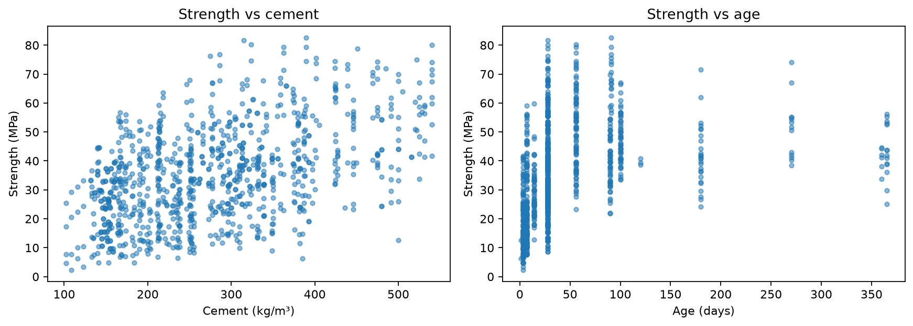

### A3 — Train/test split

I used **804** training rows and **201** test rows (80/20, `random_state=42`). All model fitting and scaling for supervised learning use the training data only.

### A4 — Linear regression

The fitted equation is below. Strength and intercept are in MPa; ingredient coefficients are in MPa per kg/m³, and the age coefficient is in MPa/day.

`y_hat (MPa) = -23.38935 +0.11667 * cement +0.09807 * slag +0.08458 * ash -0.13139 * water +0.33148 * superplastic +0.01552 * coarse_agg +0.02065 * fine_agg +0.11064 * age`

| train_RMSE_MPa | test_RMSE_MPa | test_MAE_MPa | train_R2 | train_adjusted_R2 | test_R2 |
| --- | --- | --- | --- | --- | --- |
| 10.002 | 11.191 | 8.895 | 0.610 | 0.606 | 0.580 |

Residuals are measured strength minus predicted strength. Their average changes with curing age, suggesting that a straight-line age term misses part of the curing effect.

| group | count | mean |
| --- | --- | --- |
| 1–7 days | 56 | -10.406 |
| 8–28 days | 89 | 4.570 |
| 29–90 days | 27 | 9.197 |
| 91–365 days | 29 | 2.355 |

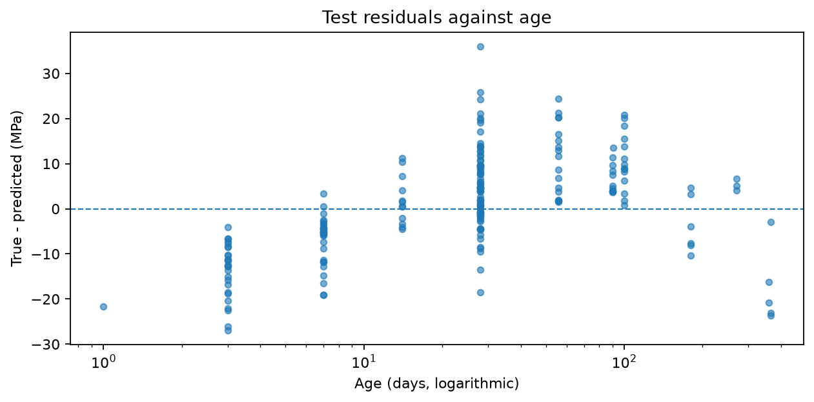

### A5 — Polynomial regression

I tested degrees 1–4 with polynomial features, scaling and linear regression in a pipeline.

| degree | p | train_RMSE_MPa | test_RMSE_MPa | train_R2 | train_adjusted_R2 | test_R2 |
| --- | --- | --- | --- | --- | --- | --- |
| 1 | 8 | 10.002 | 11.191 | 0.610 | 0.606 | 0.580 |
| 2 | 44 | 6.989 | 8.308 | 0.809 | 0.798 | 0.769 |
| 3 | 164 | 4.396 | 5.952 | 0.925 | 0.905 | 0.881 |
| 4 | 494 | 2.334 | 39.410 | 0.979 | 0.945 | -4.206 |

**Degree 3** has the smallest test RMSE (5.952 MPa). Degree 4 creates 494 features for 804 training rows: its training error is low but the test error grows sharply. Adjusted R² alone does not prevent overfitting.

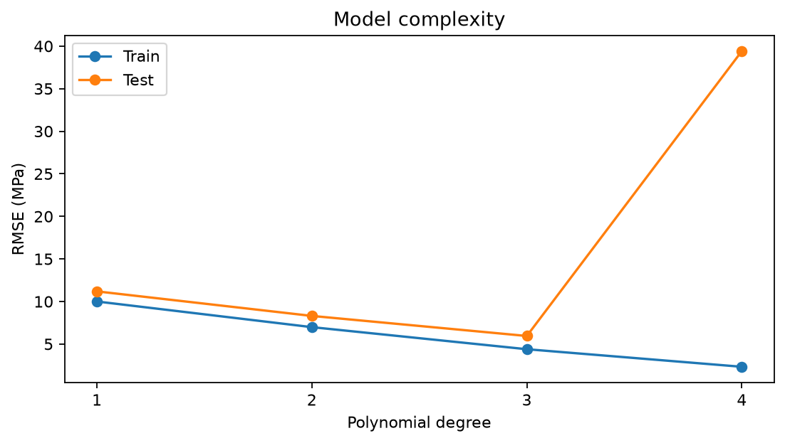

### A6 — Classifiers (40 MPa)

Class 1 means strength ≥40 MPa; class 0 means below 40 MPa. I excluded strength from the inputs and used a stratified 80/20 split. The positive-class fraction is 0.358.

**KNN:** I scaled features before measuring distances and tested all the required K values.

| K | train_accuracy | test_accuracy |
| --- | --- | --- |
| 1 | 0.998 | 0.831 |
| 3 | 0.934 | 0.801 |
| 5 | 0.907 | 0.816 |
| 7 | 0.893 | 0.836 |
| 15 | 0.848 | 0.826 |
| 25 | 0.841 | 0.806 |
| 51 | 0.805 | 0.781 |
| 101 | 0.757 | 0.736 |

I chose **K=7** (highest observed test accuracy). Its scaled accuracy is 0.836, compared with 0.821 without scaling. The five repeated splits show how much accuracy varies:

| random_state | test_accuracy |
| --- | --- |
| 0 | 0.801 |
| 1 | 0.851 |
| 2 | 0.821 |
| 3 | 0.836 |
| 4 | 0.806 |

Mean accuracy = 0.823, SD = 0.021. Small differences between K values may depend on the split.

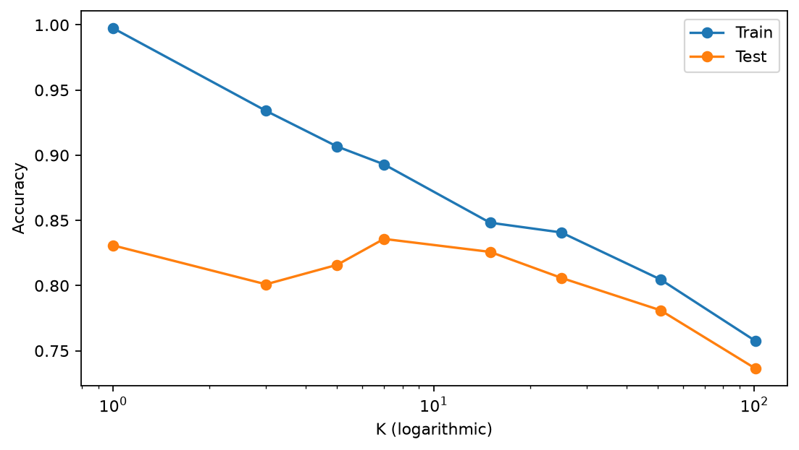

**Decision tree:** I used entropy and compared depths 1, 2, 3, 4, 5, 6, 8 and unlimited.

| max_depth | actual_depth | leaves | train_accuracy | test_accuracy |
| --- | --- | --- | --- | --- |
| 1 | 1 | 2 | 0.755 | 0.701 |
| 2 | 2 | 4 | 0.755 | 0.701 |
| 3 | 3 | 8 | 0.840 | 0.796 |
| 4 | 4 | 16 | 0.869 | 0.826 |
| 5 | 5 | 26 | 0.889 | 0.846 |
| 6 | 6 | 38 | 0.930 | 0.841 |
| 8 | 8 | 61 | 0.973 | 0.856 |
| None | 11 | 80 | 0.998 | 0.881 |

The highest observed test accuracy was at **max_depth=None**. Deeper trees fit training data more closely but are harder to read and can overfit; limiting depth gives simpler decisions but may lower accuracy. The first question is `age <= 42.00`, which is physically reasonable because curing time affects strength.

```text
|--- age <= 42.00
|   |--- cement <= 257.70
|   |   |--- water <= 156.20
|   |   |   |--- truncated branch of depth 6
|   |   |--- water >  156.20
|   |   |   |--- truncated branch of depth 7
|   |--- cement >  257.70
|   |   |--- superplastic <= 0.95
|   |   |   |--- truncated branch of depth 7
|   |   |--- superplastic >  0.95
|   |   |   |--- truncated branch of depth 9
|--- age >  42.00
|   |--- superplastic <= 6.45
|   |   |--- fine_agg <= 749.55
|   |   |   |--- truncated branch of depth 5
|   |   |--- fine_agg >  749.55
|   |   |   |--- truncated branch of depth 8
|   |--- superplastic >  6.45
|   |   |--- cement <= 203.35
|   |   |   |--- truncated branch of depth 3
|   |   |--- cement >  203.35
|   |   |   |--- truncated branch of depth 4
```

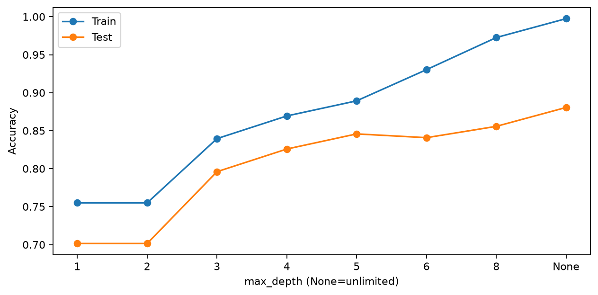

### A7 — Classification metrics and threshold

A **false positive** is the dangerous error here: the model says concrete reaches 40 MPa when it does not. Precision measures the fraction of predicted-positive mixtures that really reach the target.

| model | TP | FP | FN | TN | accuracy | precision | recall | F1 |
| --- | --- | --- | --- | --- | --- | --- | --- | --- |
| KNN K=7 | 54 | 15 | 18 | 114 | 0.836 | 0.783 | 0.750 | 0.766 |
| Tree depth=None | 61 | 13 | 11 | 116 | 0.881 | 0.824 | 0.847 | 0.836 |

I tested four probability thresholds using KNN:

| threshold | TP | FP | FN | TN | precision | recall |
| --- | --- | --- | --- | --- | --- | --- |
| 0.300 | 61 | 23 | 11 | 106 | 0.726 | 0.847 |
| 0.500 | 54 | 15 | 18 | 114 | 0.783 | 0.750 |
| 0.700 | 39 | 11 | 33 | 118 | 0.780 | 0.542 |
| 0.900 | 18 | 1 | 54 | 128 | 0.947 | 0.250 |

I chose **0.9** to limit false positives (1 on this test split). The cost is lower recall: more mixtures that actually pass are rejected. KNN neighbour fractions are not certified safety probabilities.

### A8 — Feature importance

I compared raw and standardised regression coefficients, tree impurity importance and permutation importance measured by F1 loss.

| feature | raw_coef | standardized_coef_MPa | tree_importance | knn_perm_F1 | knn_perm_SD | tree_perm_F1 | tree_perm_SD |
| --- | --- | --- | --- | --- | --- | --- | --- |
| cement | 0.117 | 12.119 | 0.253 | 0.165 | 0.036 | 0.211 | 0.031 |
| slag | 0.098 | 8.437 | 0.053 | 0.055 | 0.021 | 0.027 | 0.015 |
| ash | 0.085 | 5.440 | 0.044 | 0.016 | 0.016 | 0.022 | 0.014 |
| water | -0.131 | -2.828 | 0.106 | 0.068 | 0.025 | 0.076 | 0.025 |
| superplastic | 0.331 | 1.971 | 0.149 | 0.066 | 0.032 | 0.169 | 0.029 |
| coarse_agg | 0.016 | 1.199 | 0.023 | 0.038 | 0.018 | 0.007 | 0.006 |
| fine_agg | 0.021 | 1.670 | 0.101 | 0.081 | 0.025 | 0.075 | 0.021 |
| age | 0.111 | 6.895 | 0.272 | 0.176 | 0.033 | 0.200 | 0.024 |

By absolute raw coefficients the leading features are **superplastic, water, cement**; after scaling they are **cement, slag, age**. The rankings differ because inputs have different units and ranges. The tree mainly uses **age, cement, superplastic**, while KNN permutation importance highlights **age, cement, fine_agg**. These rankings broadly relate to binder content and curing age, but importance alone does not prove causation.

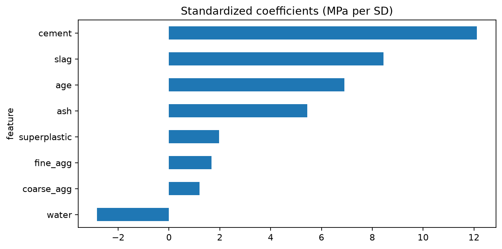
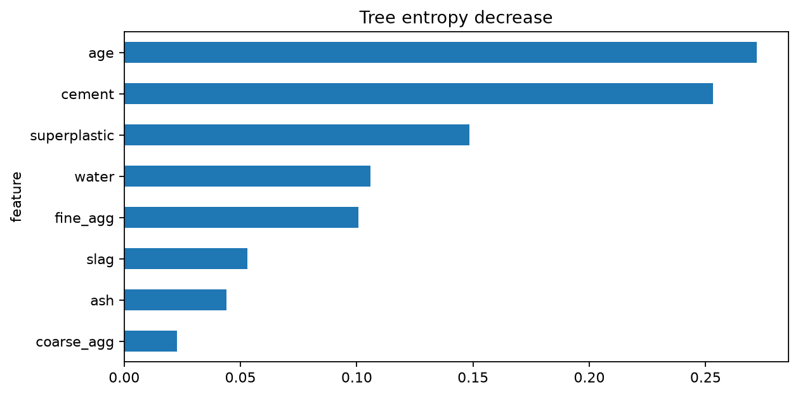
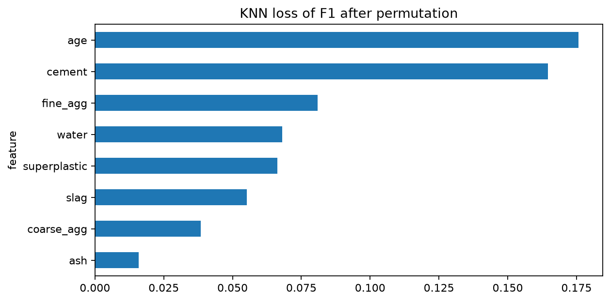

### Session A bonus — Physics-based features

I tried `log(age)` and the water-to-binder ratio `water/(cement + slag + ash)` without adding more input columns.

| model | features | test_RMSE_MPa | test_R2 |
| --- | --- | --- | --- |
| log(age) | 8 | 7.652 | 0.804 |
| log(age) + water/binder | 8 | 7.600 | 0.806 |

These transformations substantially improve the basic linear model, although polynomial degree 3 still has the smaller test RMSE in this experiment.

<!-- SESSION_A_END -->

## Session B — Wine

<!-- SESSION_B_START -->
### B1 — Wine dataset

`load_wine(as_frame=True)` provides **178 wines** and **13 chemical measurements** from three cultivars in one Italian region. The features include alcohol, acids, magnesium, phenols, colour measurements and proline. Cultivar labels are kept aside until B6. I printed `wine.DESCR` and `X.describe()`. **proline, magnesium, alcalinity_of_ash** have the largest standard deviations; **nonflavanoid_phenols, hue, ash** have the smallest. **proline, magnesium, alcalinity_of_ash** have the largest ranges.

### B2 — PCA on raw data

Raw PC1 explains **99.81%** of the variance. Its loadings, sorted by value, are:

| feature | PC1_raw_loading |
| --- | --- |
| proline | 1.000 |
| magnesium | 0.018 |
| color_intensity | 0.002 |
| alcohol | 0.002 |
| flavanoids | 0.002 |
| total_phenols | 0.001 |
| od280/od315_of_diluted_wines | 0.001 |
| proanthocyanins | 0.001 |
| ash | 0.000 |
| hue | 0.000 |
| nonflavanoid_phenols | -0.000 |
| malic_acid | -0.001 |
| alcalinity_of_ash | -0.005 |

**proline** dominates because its numerical scale is much larger. PCA centres data but does not automatically scale it, so this PC1 is not a balanced summary of all chemical measurements.

### B3 — PCA after scaling

After `StandardScaler`, the feature means are approximately 0 and standard deviations approximately 1.

| PC | variance_ratio | cumulative_ratio |
| --- | --- | --- |
| 1 | 0.362 | 0.362 |
| 2 | 0.192 | 0.554 |
| 3 | 0.111 | 0.665 |
| 4 | 0.071 | 0.736 |
| 5 | 0.066 | 0.802 |
| 6 | 0.049 | 0.851 |
| 7 | 0.042 | 0.893 |
| 8 | 0.027 | 0.920 |
| 9 | 0.022 | 0.942 |
| 10 | 0.019 | 0.962 |
| 11 | 0.017 | 0.979 |
| 12 | 0.013 | 0.992 |
| 13 | 0.008 | 1.000 |

**8 components** explain at least 90% of the variance. PC1 and PC2 together explain **55.41%**. Loadings are shown below, sorted separately by each component.

**Sorted by PC1:**

| feature | PC1 | PC2 |
| --- | --- | --- |
| nonflavanoid_phenols | -0.299 | 0.029 |
| malic_acid | -0.245 | 0.225 |
| alcalinity_of_ash | -0.239 | -0.011 |
| color_intensity | -0.089 | 0.530 |
| ash | -0.002 | 0.316 |
| magnesium | 0.142 | 0.300 |
| alcohol | 0.144 | 0.484 |
| proline | 0.287 | 0.365 |
| hue | 0.297 | -0.279 |
| proanthocyanins | 0.313 | 0.039 |
| od280/od315_of_diluted_wines | 0.376 | -0.164 |
| total_phenols | 0.395 | 0.065 |
| flavanoids | 0.423 | -0.003 |

**Sorted by PC2:**

| feature | PC1 | PC2 |
| --- | --- | --- |
| hue | 0.297 | -0.279 |
| od280/od315_of_diluted_wines | 0.376 | -0.164 |
| alcalinity_of_ash | -0.239 | -0.011 |
| flavanoids | 0.423 | -0.003 |
| nonflavanoid_phenols | -0.299 | 0.029 |
| proanthocyanins | 0.313 | 0.039 |
| total_phenols | 0.395 | 0.065 |
| malic_acid | -0.245 | 0.225 |
| magnesium | 0.142 | 0.300 |
| ash | -0.002 | 0.316 |
| proline | 0.287 | 0.365 |
| alcohol | 0.144 | 0.484 |
| color_intensity | -0.089 | 0.530 |

Positive PC1 means more **flavanoids, total_phenols, od280/od315_of_diluted_wines** and less **nonflavanoid_phenols, malic_acid, alcalinity_of_ash**; negative PC1 is the reverse. Positive PC2 means more **color_intensity, alcohol, proline** and less **hue, od280/od315_of_diluted_wines, alcalinity_of_ash**; negative PC2 is the reverse. From the unlabelled plot, I would guess about three overlapping groups.

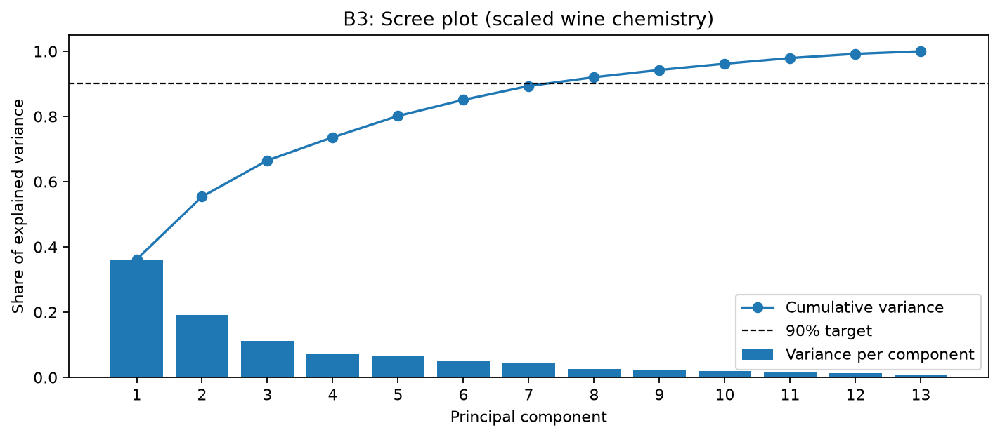
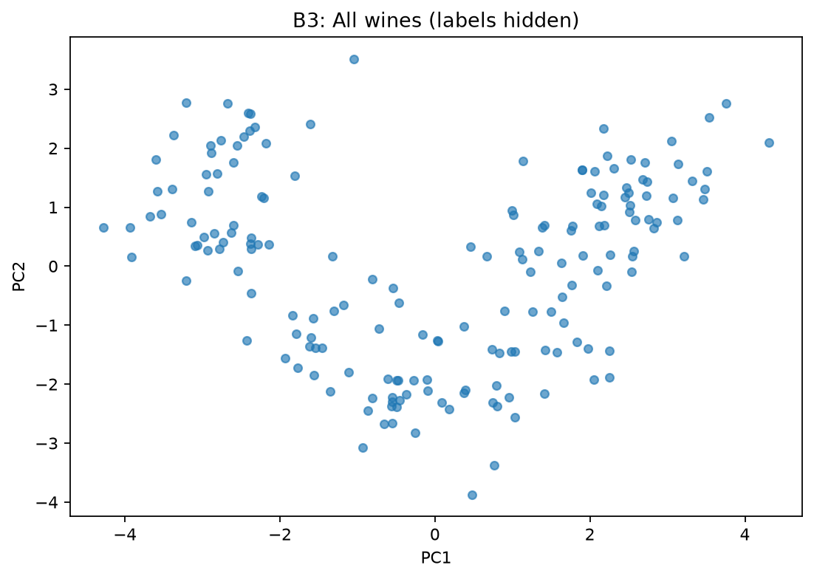

### B4 — K-Means

With `k=3`, eight runs using `n_init=1` and seeds 0–7 gave different inertia values:

| seed | inertia |
| --- | --- |
| 0 | 1277.928 |
| 1 | 1278.761 |
| 2 | 1277.928 |
| 3 | 1277.928 |
| 4 | 1279.966 |
| 5 | 1278.761 |
| 6 | 1282.464 |
| 7 | 1278.761 |

Different starting centres can produce different solutions. `n_init=10` tests ten starts and keeps the lowest inertia. I then calculated inertia for k=1–10:

| k | inertia |
| --- | --- |
| 1 | 2314.000 |
| 2 | 1659.008 |
| 3 | 1277.928 |
| 4 | 1180.738 |
| 5 | 1110.365 |
| 6 | 1044.470 |
| 7 | 995.995 |
| 8 | 944.559 |
| 9 | 913.197 |
| 10 | 864.578 |

I chose **k=3** near the elbow. Inertia keeps decreasing as k increases, so the minimum alone cannot determine a useful k.

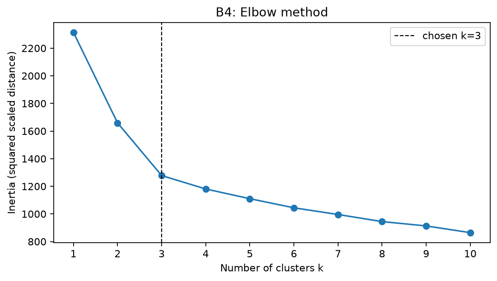

### B5 — Cluster interpretation

Cluster sizes:

| cluster | size |
| --- | --- |
| 0 | 65 |
| 1 | 51 |
| 2 | 62 |

Centres converted back to original measurement units:

| cluster | alcohol | malic_acid | ash | alcalinity_of_ash | magnesium | total_phenols | flavanoids | nonflavanoid_phenols | proanthocyanins | color_intensity | hue | od280/od315_of_diluted_wines | proline |
| --- | --- | --- | --- | --- | --- | --- | --- | --- | --- | --- | --- | --- | --- |
| 0 | 12.251 | 1.897 | 2.231 | 20.063 | 92.738 | 2.248 | 2.050 | 0.358 | 1.624 | 2.973 | 1.063 | 2.803 | 510.169 |
| 1 | 13.134 | 3.307 | 2.418 | 21.241 | 98.667 | 1.684 | 0.819 | 0.452 | 1.146 | 7.235 | 0.692 | 1.697 | 619.059 |
| 2 | 13.677 | 1.998 | 2.466 | 17.463 | 107.968 | 2.848 | 3.003 | 0.292 | 1.922 | 5.454 | 1.065 | 3.163 | 1100.226 |

Using the chemical measurements that differ most from the dataset average:

- **Cluster 0 (65 wines):** lower alcohol (-0.93 SD); lower color_intensity (-0.90 SD); lower proline (-0.75 SD).
- **Cluster 1 (51 wines):** lower od280/od315_of_diluted_wines (-1.29 SD); lower flavanoids (-1.22 SD); lower hue (-1.16 SD).
- **Cluster 2 (62 wines):** higher proline (+1.13 SD); higher flavanoids (+0.98 SD); higher total_phenols (+0.89 SD).

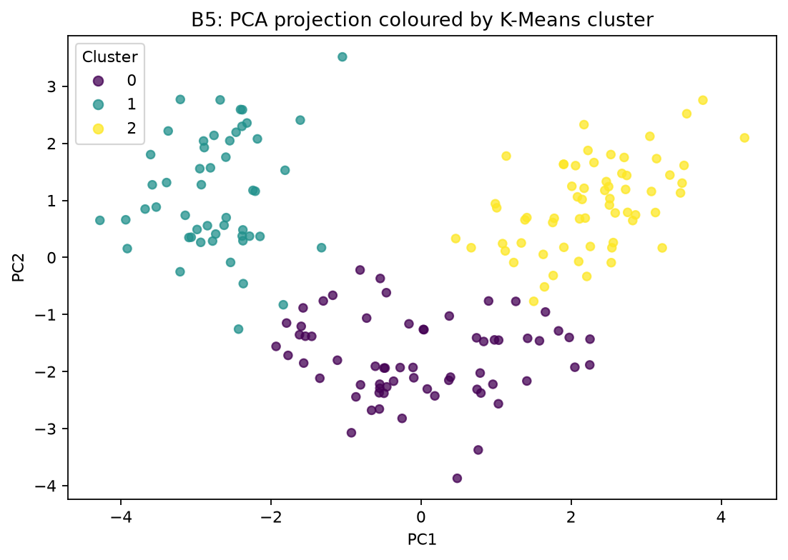

### B6 — Compare with cultivars

Only after clustering did I compare the groups with the actual cultivars. Cluster numbers are arbitrary.

| cultivar | 0 | 1 | 2 |
| --- | --- | --- | --- |
| 0 | 0 | 0 | 59 |
| 1 | 65 | 3 | 3 |
| 2 | 0 | 48 | 0 |

Agreement is the sum of the most common cultivar count in each cluster divided by 178.

| model | agreement |
| --- | --- |
| scaled (13 features) | 0.966 |
| raw/unscaled (13 features) | 0.702 |
| scaled PC1+PC2 only | 0.966 |

Scaling improves agreement from **70.22%** to **96.63%** because Euclidean distances otherwise favour large-number measurements. The first two scaled PCs retain 55.41% of variance yet give **96.63%** agreement, suggesting useful cultivar separation is visible in this plane. Agreement measures the discovered groups on these wines, not accuracy on unseen wines.

### Session B bonus — With labels

I compared two supervised KNN pipelines on a stratified 75/25 split. Scaling and PCA were fitted only on the training subset.

| model | test_accuracy |
| --- | --- |
| Scaled KNN(5): all 13 features | 0.933 |
| Scaled PCA(2) + KNN(5) | 0.933 |

These test accuracies cannot be directly compared with unsupervised agreement: clustering used all 178 wines and the cultivars were only matched afterward.

<!-- SESSION_B_END -->

## B7 — Snakemake

I used four rules: `fetch` downloads concrete; `session_a` uses its CSV and code; `session_b` runs independently; `all` requires the two final CSV files.

- `snakemake -n` showed what would run without executing anything.
- After deleting `data/` and `results/`, `snakemake --cores 1` rebuilt all four rules successfully.
- Running it again printed that everything was up to date.
- Changing a K value in `sessionA.py` caused only `session_a` to run again, not `fetch` or `session_b`. I then restored the required K list and reran it.

The reproducibility command is **`snakemake --cores 1`**.
